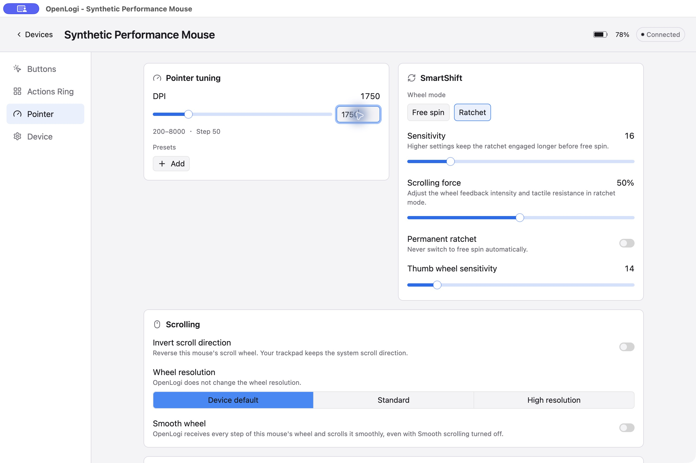
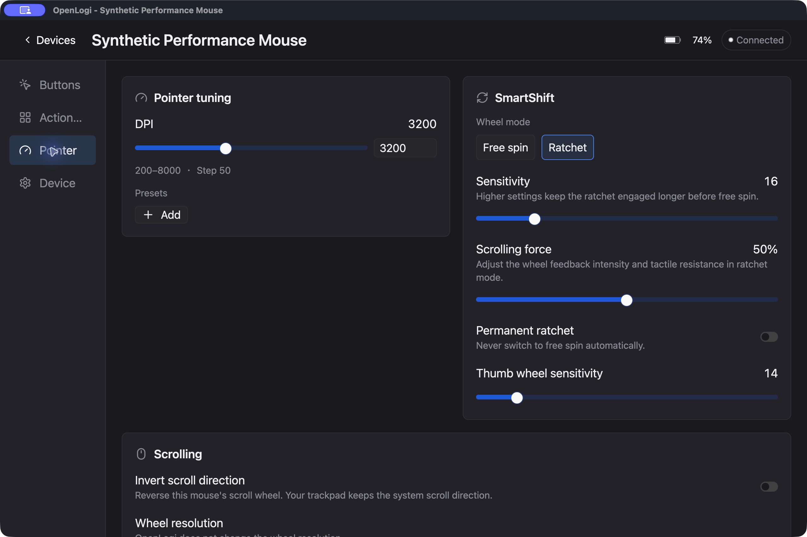
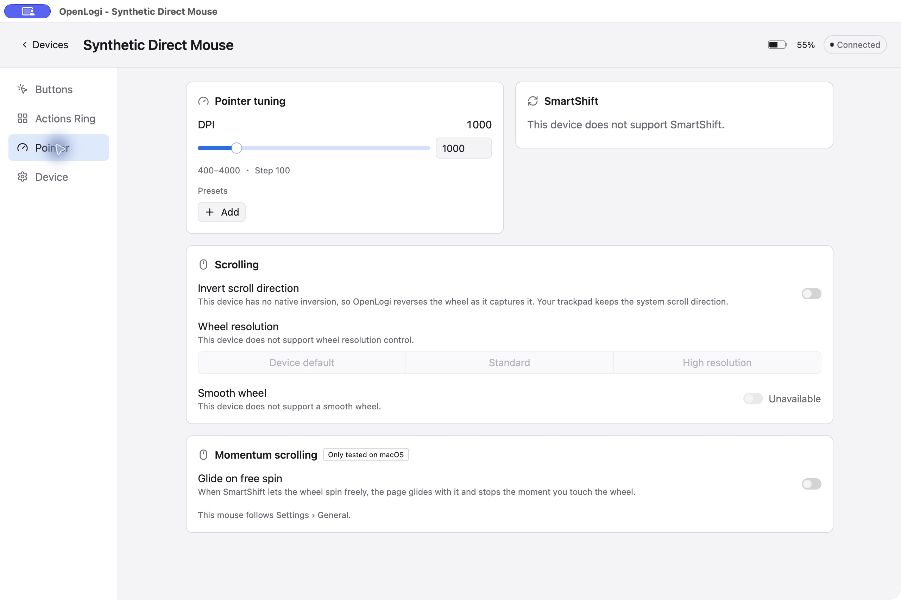

# DPI input integration evidence

These screenshots show the native macOS arm64 application built from integration commit `147f112005fd716be05760ac7d68276260422397`, based on upstream master `aec0dee95e26d13427f61c719cc001c9ba9e8e9d` for AprilNEA/OpenLogi#1059. Submission head `932fcd7d92837ab522151832d47c4df30b8390ae` additionally adds a terminal newline to one fixture manifest; its parsed JSON is unchanged and offline fixture verification passed.

The application used an isolated dev profile and the built-in mock agent. These are application screenshots with synthetic devices. They do not establish physical-device DPI writes, reconnect behavior, Linux or Windows behavior, or production packaging.

Typing 1733 and pressing Enter showed 1750. Leaving the field committed 2300. Typing 3200 and selecting another mouse left the second mouse at its own 1000; returning to the first mouse showed 3200. The application log contains exactly three numeric commits and three DPI request/response pairs.

The host gate passed 4565 unit/integration tests with 0 failures and 3 ignored, plus 1 passed and 2 ignored doctests. All 12 focused DPI tests passed within the workspace suite. Formatting, workspace Clippy, non-GUI rustdoc, AST/spelling guards, and the desktop/mock build passed. The final push hooks also passed.

## Light theme at 100%

## Dark theme at 125%

## Second mouse

Integration and rejection fix: Harris. Original contributor history is retained in the feature branch.
